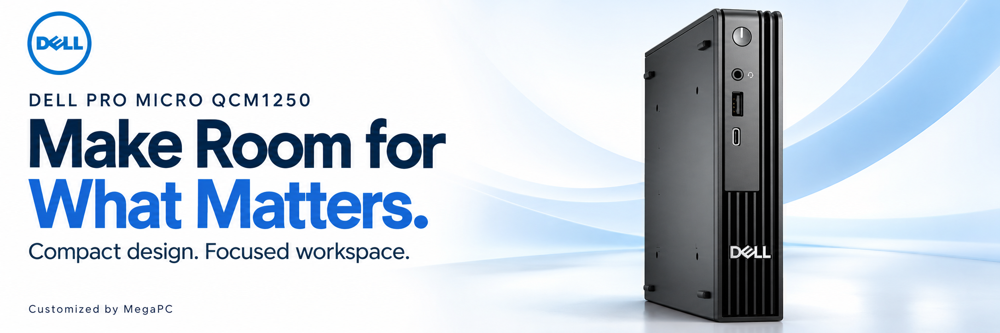
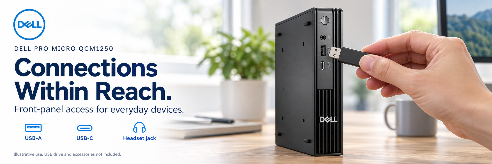
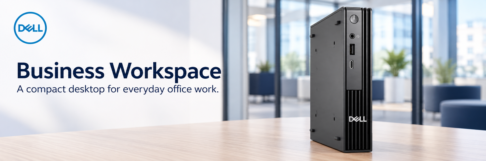
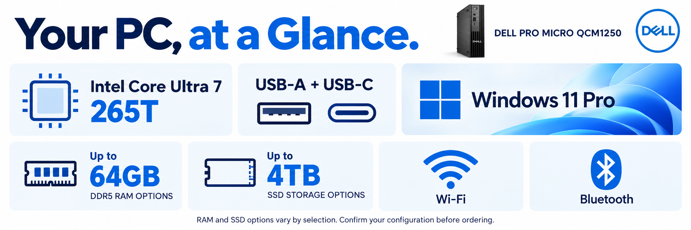
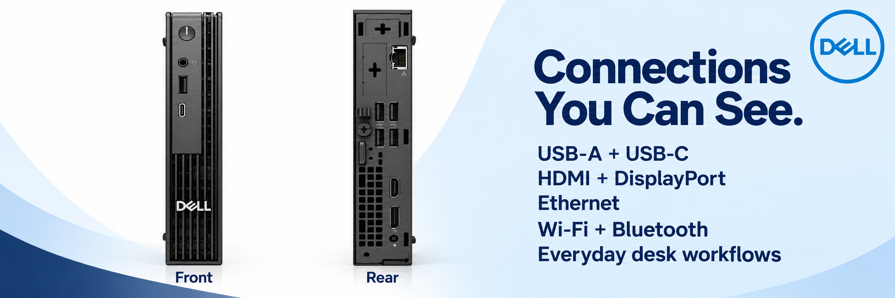
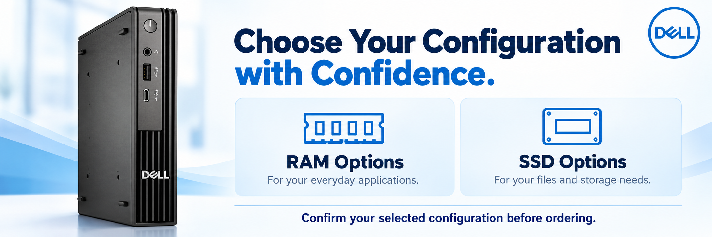
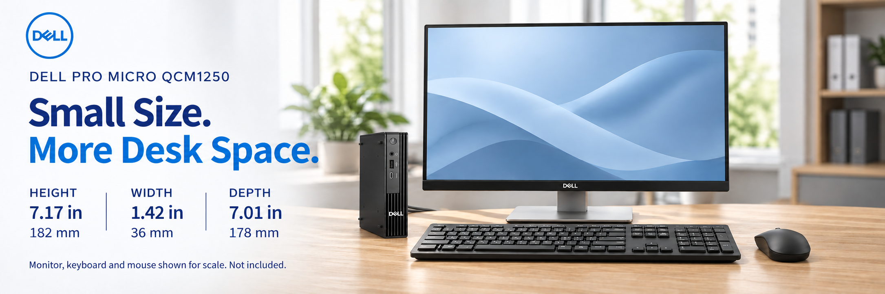
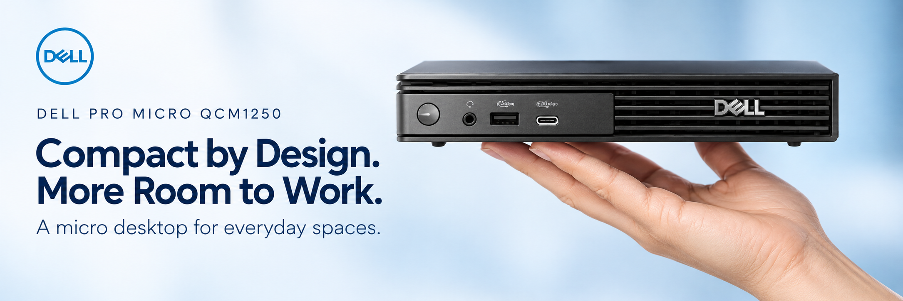
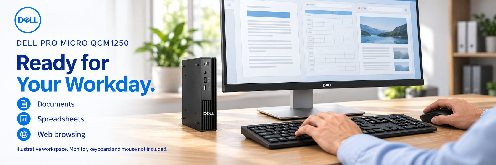

# VD-744 · 内容交付 v1

本次已产出九张图片母版、两套 A+ 内容文案与模块顺序、通用视频 AI 脚本和旁白／字幕文字。**这是创意内容审核版，不是后台适配完成包，也没有视频成片。**

- [普通 A+ 内容](../basic/copy.md)
- [Premium A+ / A++ 内容](../premium/copy.md)
- [完整视频脚本与逐镜头提示词](../video/script.md)
- [旁白文字](../video/voiceover.txt) · [字幕文件](../video/subtitles.srt)
- [图片与来源清单](manifest.json) · [创意检查记录](../review/creative-review.md)

## 图片预览

### 01 · 产品主视觉

2026-10-27：按用户要求移除图内左下角的「Customized by MegaPC」，保留现有交付路径与 2172×724 尺寸。其余五张图片未修改。

### 02 · 工作日核心功能

### 03 · 企业办公场景

### 04 · 居家办公场景

### 05 · 连接说明

### 06 · 配置选择

### pt07 · 机身大小对比

2026-10-27：用户确认新版并要求更新 `pt07`。按用户提供的摆位参考，主机置于显示器左侧，键盘居中、鼠标在右侧，以自然办公桌面衬托机身小巧。标注 Dell 官方 QCM1250 机身尺寸：高 182 mm × 宽 36 mm × 深 178 mm。显示器、键盘与鼠标仅供场景及大小参照，不包含在商品内；原有六张图与两套文案保持不变。

[尺寸来源与审核记录](../review/pt07-office-comparison-20261027.json) · [制作提示词](../review/pt07-office-generation-prompts.txt)

### pt08 · 手托主机，展现紧凑形态

采用用户提供的托举构图，产品外观依据当前 QCM1250 原图。手部为小巧形态的视觉说明，不代表售出实机称重或托举承重测试，未加入重量数字或轻量化承诺。

### pt09 · 日常办公用途

围绕文档、表格和网页办公的普通使用情景；屏幕为通用示意界面，不承诺付费软件随附。显示器、键盘、鼠标仅为场景道具，不包含在商品内。

pt08／pt09 已于 2026-10-27 获用户批准上传，原有七张图保持不变。[制作与证据记录](../review/nine-image-extension-20261027.json) · [生成提示词](../review/pt08-pt09-generation-prompts-20261027.txt)

## 模块与素材映射

| 图片 | 普通 A+ | Premium A+ |
|---|---|---|
| 01 hero | B01 产品识别 | P01 主视觉，可配视频；P06 可改用原图＋原生文字 |
| 02 workday | B02 核心价值 | P02 功能速览 |
| 03 business / 04 home | B03 两个场景 | P03 轮播候选的两页 |
| 05 connections | B04 连接说明 | P04 热点候选；无线支持用原生文字 |
| 06 configuration | B05 配置选择 | P05 配置说明 |
| pt07 size comparison | 机身尺寸补充图，模块待适配 | 机身尺寸补充图，模块待适配 |
| pt08 in-hand form | 紧凑形态补充图，模块待适配 | 紧凑形态补充图，模块待适配 |
| pt09 everyday work | 办公用途补充图，模块待适配 | 办公用途补充图，模块待适配 |
| 原生文字 | 标题与正文 | P06 产品来源；P07 Q&A |

母版 01/02/03/05/pt09 为 2172×724，04/06/pt08 为 2170×725，当前 pt07 为 2171×724；尺寸来自实际文件检查，约 3:1。细小尺寸差异保留原始输出，尚未统一导出。九张图片不等于九个后台模块。当前后台访问曾显示 Access Required；需要权限后核实真实模块、像素要求、字段限制、移动端重排及 ASIN 可应用性。不要将母版直接称为可上传版本。

## 内容范围

产品：VD-744，Dell Pro Micro QCM1250，Intel Core Ultra 7 265T。使用 Dell 品牌视觉，保留 MegaPC 定制身份。RAM/SSD 配置中性，不承诺容量、价格、配件、保修、无线代际、多屏数量或性能百分比。所有图片采用内置 imagegen，准确原图与原始 Dell Logo 为参考；AI 生成结果不是原始产品像素，也不声称与照片像素完全一致。
