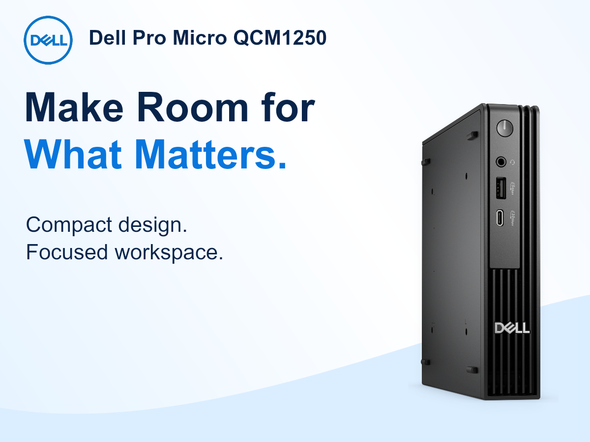
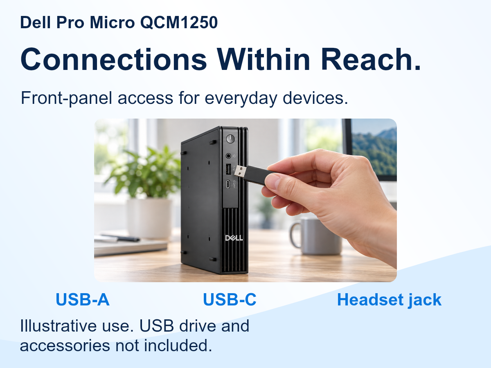
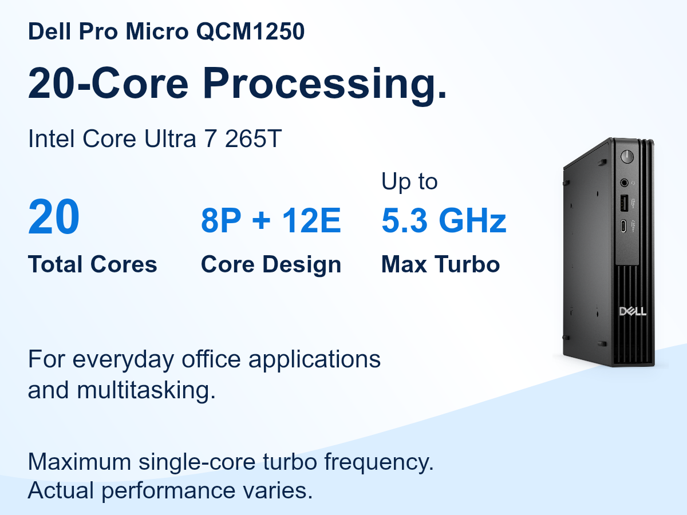
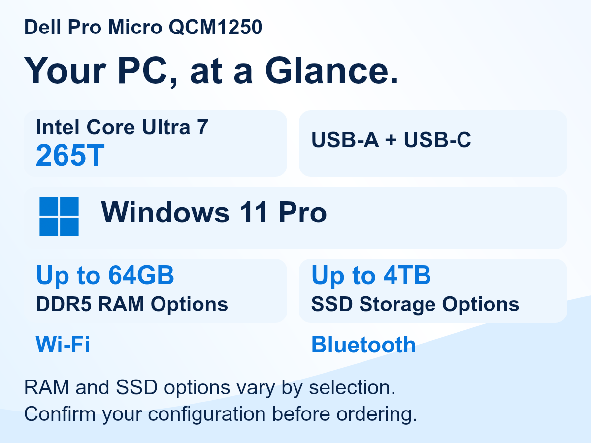
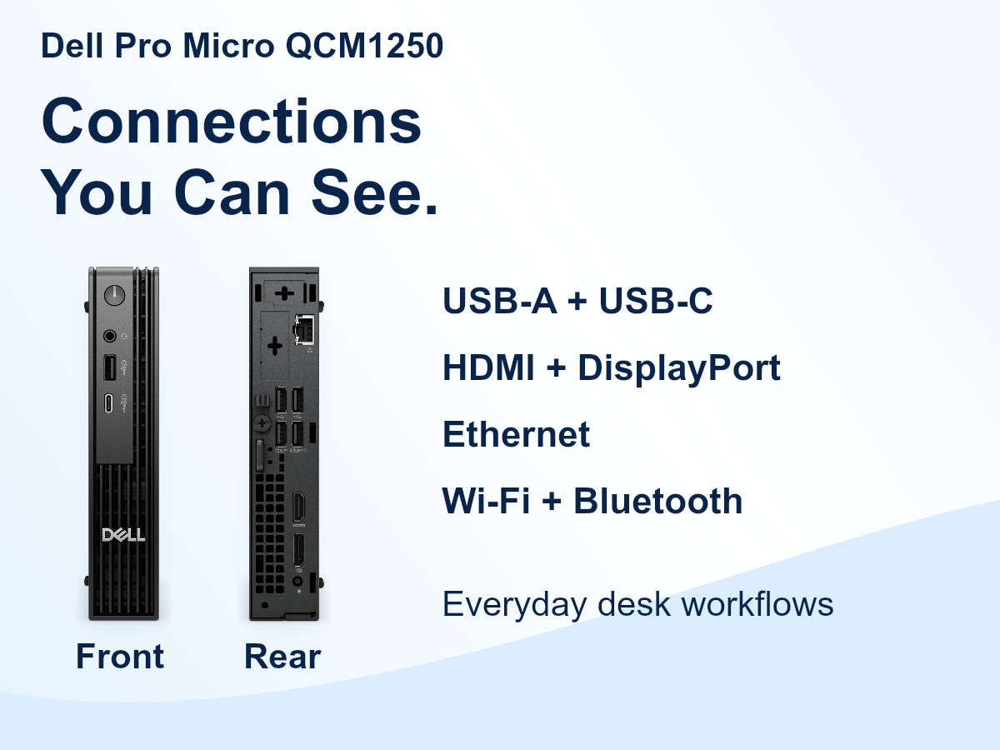
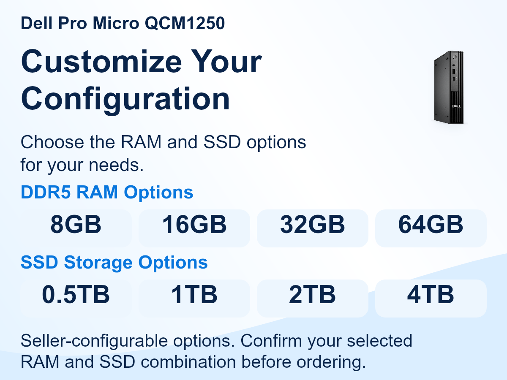
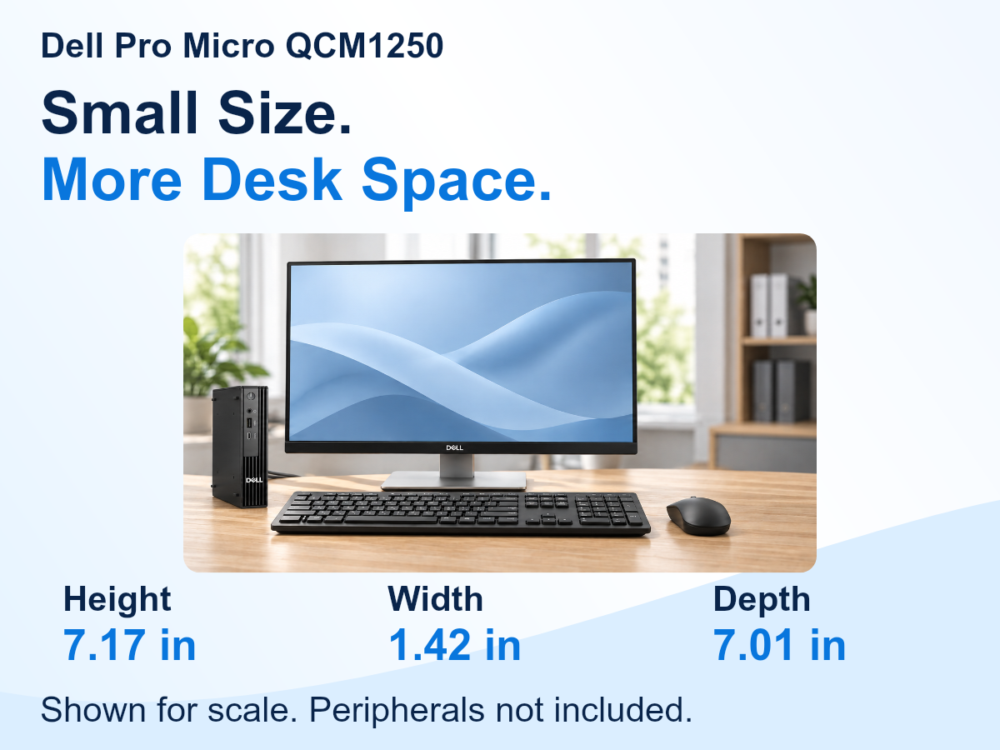
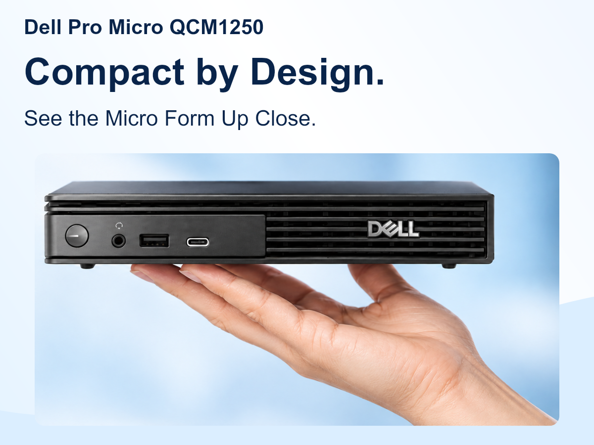
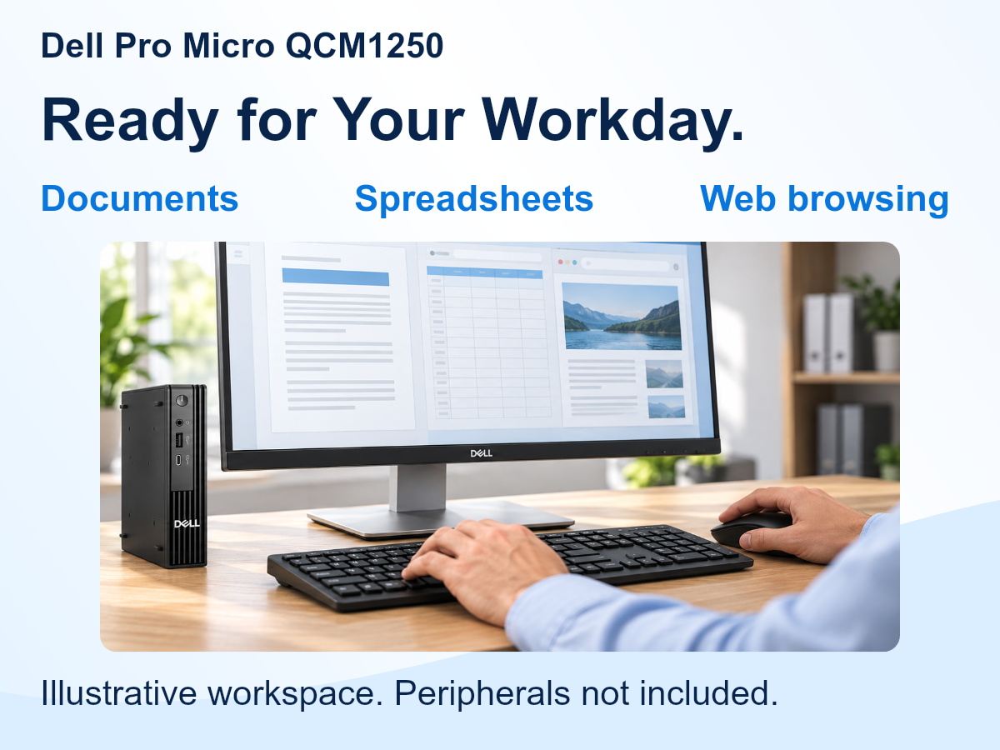

# VD-744 · 独立 Mobile A+ 图片

2026-10-29 完善版：沿用原白蓝商务方向和九个内容主题，采用手机大字与独立排版。统一 **1200×900（4:3）sRGB PNG、72dpi、单张小于2MB**；最小图中文字42px，在360px宽预览中约12.6px。此字号是内部设计起点，不是冒充Amazon统一规定。

已完善：放大正文/限定；独立 Dell Logo 仅在01；04使用原始Windows标识；08只修复两个乱码小字补丁；九条Alt均≤100字符；02/08/09原PNG嵌入AI人物披露标签。原桌面九图不覆盖，之前的手机版本保留在Git历史基线 2545aff4496ed957031a248015db96d9546e8827。

[独立手机设计入口](../../../../MOBILE.md) · [逐图Body与Alt](../mobile/copy.md) · [当前配方](../mobile/design.json) · [文件/哈希/图层清单](mobile-manifest.json) · [修订与视觉记录](../review/mobile-refinement-20261029.json)

点击文件后用 GitHub 的 **Download raw file** 下载原PNG。不要下载网页缩略图或截图，以免丢失像素和元数据。该包完成图片与上传字段准备；实际后台上传/整页预览/ASIN应用/发布未执行。九张素材不承诺九个后台模块。

| 图 | 桌面原图 | 手机原文件 | 大小 | AI人物标签 |
|---|---|---|---|---|
| 01 | [桌面](../shared/assets/01-hero-v1.png) | [01-hero-mobile.png](../premium/assets/mobile/01-hero-mobile.png) | 0.25 MB | 不适用 |
| 02 | [桌面](../shared/assets/02-workday-v1.png) | [02-workday-mobile.png](../premium/assets/mobile/02-workday-mobile.png) | 0.45 MB | 已嵌入 |
| 03 | [桌面](../shared/assets/03-business-v1.png) | [03-business-mobile.png](../premium/assets/mobile/03-business-mobile.png) | 0.21 MB | 不适用 |
| 04 | [桌面](../shared/assets/04-home-office-v1.png) | [04-home-office-mobile.png](../premium/assets/mobile/04-home-office-mobile.png) | 0.13 MB | 不适用 |
| 05 | [桌面](../shared/assets/05-connections-v1.png) | [05-connections-mobile.png](../premium/assets/mobile/05-connections-mobile.png) | 0.22 MB | 不适用 |
| 06 | [桌面](../shared/assets/06-configuration-v1.png) | [06-configuration-mobile.png](../premium/assets/mobile/06-configuration-mobile.png) | 0.17 MB | 不适用 |
| 07 | [桌面](../shared/assets/pt07.png) | [pt07-mobile.png](../premium/assets/mobile/pt07-mobile.png) | 0.42 MB | 不适用 |
| 08 | [桌面](../shared/assets/pt08.png) | [pt08-mobile.png](../premium/assets/mobile/pt08-mobile.png) | 0.61 MB | 已嵌入 |
| 09 | [桌面](../shared/assets/pt09.png) | [pt09-mobile.png](../premium/assets/mobile/pt09-mobile.png) | 0.59 MB | 已嵌入 |

## 手机图片

## 使用范围

完整容量选项、单核睿频限定、外设不随附及软件边界在图内或对应原生正文中保留。尺寸仅用英寸，原始mm证据保留在旧研究记录中。办公/手托照片为示意，不代表严格尺度校准、重量/承重测试或实机检验。所有文件技术与视觉检查状态独立于Amazon审核。
